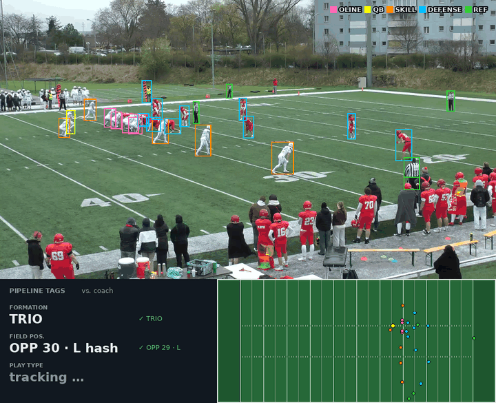
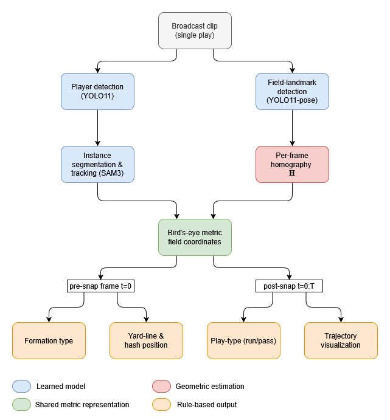
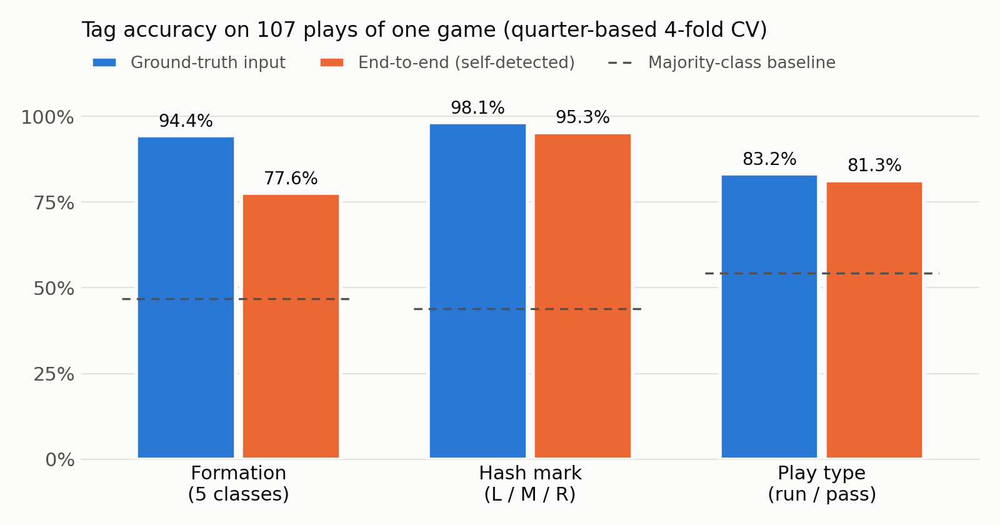

# Broadcast to Bird's-Eye: Automated Play Tagging for American Football

**A proof-of-concept computer-vision pipeline that watches single-camera amateur game film and tags each play with its offensive formation, field position and run/pass type.**

<p align="center">
  
  <br>
  <sub>Real pipeline output on one play. Boxes: predicted player roles. Bottom right: players projected onto a metric bird's-eye field. Bottom left: the pipeline's tags next to the coach's tags. The player detector never trained on this stadium, and the field model never saw this quarter.</sub>
</p>

## TL;DR

- On **107 plays**, the fully automatic pipeline tagged the **formation correctly in 77.6%** of plays and **run vs. pass in 81.3%**. It placed the **line of scrimmage within 0.79 yards** on average and got the **hash mark right in 95.3%**.
- In a small study with two coaches, reviewing the pipeline's tags took **15 minutes instead of 41** for 50 plays, **63% less time** for the three tags covered.
- ⚠️ **All results come from one game in one stadium.** This is a proof of concept. It shows the approach works, but it has not been shown to generalize.

## Why this matters

Coaches and video analysts tag every play of every game by hand: formation, field position, play type, down & distance, result. This is what lets them scout an opponent's tendencies. It is also hours of repetitive clicking per game, which is time they don't spend coaching.

Professional leagues solve this with multi-camera rigs or player-tracking chips. Amateur teams have one fixed camera at midfield, and so far that setting has had no automated solution.

This project asks a simple question: **can one ordinary game camera, with no extra hardware, produce useful tags automatically?** For the coach study, the tags were exported as Hudl-style sheets. That way coaches reviewed them in the tool they already use instead of typing them from scratch.

## Pipeline

<p align="center"></p>

1. **Detect players by role.** A YOLO11 detector finds every player and labels their role directly: offensive line, QB, skill player, defense or referee.
2. **Track them through the play.** SAM 3 follows each detected player across all frames of the clip.
3. **Register the field.** A YOLO11-pose model finds up to 62 field landmarks such as yard lines, numbers and hashes. From these, the pipeline fits a homography for each frame that maps pixels to real field coordinates in yards.
4. **Go bird's-eye.** Each player's foot point is projected onto a metric top-down field.
5. **Tag the play.** Transparent rule-based logic on those coordinates reads the formation (pre-snap), the yard line and hash (pre-snap) and run vs. pass (from QB and offensive-line movement after the snap).

Learned models handle perception, and simple, auditable rules handle the football logic. When a tag is wrong, you can see why.

## Results

Evaluation used 107 plays from one game (Red Tigers vs. Styrian Bears, 2026), covering both teams' offensive snaps. The field model and the taggers use quarter-based 4-fold cross-validation (train on three quarters, test on the fourth); the player detector never saw this game during training. *Ground-truth input* means hand-annotated boxes and landmarks; it tests the tagging logic on its own. *End-to-end* means the pipeline uses only its own detections.

<p align="center"></p>

| Stage | Metric | Ground-truth input | End-to-end |
|---|---|---|---|
| Player detection (5 roles) | mAP50 | – | **0.917** |
| Field registration | median player-position error | – | **0.71 yd** |
| Formation (5 classes) | accuracy | 94.4% | **77.6%** |
| Yard line | mean error | 0.54 yd | **0.79 yd** |
| Hash mark (L/M/R) | accuracy | 98.1% | **95.3%** |
| Play type (run/pass) | accuracy | 83.2% | **81.3%** |

**Coach study** (50 plays, three tags only, two coaches):

| | Manual tagging | Reviewing pipeline tags | Time saved |
|---|---|---|---|
| Coach 1 | 43 min | 18 min | 58% |
| Coach 2 | 39 min | 12 min | 69% |

## Key findings

- **Generic vision-language models were not enough.** In the preceding seminar project, off-the-shelf open VLMs that were asked to name the formation from an image did no better than guessing the most common one. That motivated a structured pipeline.
- **Player roles transfer across stadiums.** The detector reached 0.917 mAP50 on a stadium it never trained on. Pretraining on other stadiums mattered more than adding same-stadium footage, which made results slightly worse.
- **Detection is the bottleneck, not geometry.** Formation accuracy drops from 94.4% to 77.6% end-to-end. Swapping in detected landmarks alone costs nothing. Swapping in detected players causes the entire drop.
- **Pick models by the metric the business cares about.** The keypoint model with the *higher* detection rate gave *worse* field positions. The deployed model was chosen by downstream error in yards, not by detection rate.
- **Accuracy depends on where the play is.** Registration error roughly doubles near the end zones (median 1.11 yd vs. 0.48 yd at midfield), because the fixed camera sees those areas at a shallow angle.

## Limitations & next steps

**What this proof of concept does not show yet:**

- **Generalization.** One game, one stadium, one camera position. Other teams, jersey colors, camera angles, zoom levels, lighting and weather were not tested.
- **Stadium-specific parts.** The field-landmark model and the rule thresholds are tuned to this venue and this camera angle.
- **Rare formations.** WING T (8 plays) and TREY (6 plays) are too rare for reliable numbers. TREY recall end-to-end is only 16.7%.
- **Scope.** The pipeline produces 3 of the roughly 6 tags in a real tagging session. Down & distance, gain/loss and play result would need ball tracking. Special-teams plays are excluded. Clips still need a manually marked pre-snap frame.
- **Small user study.** The time savings come from two coaches. They point in a direction; they are not a robust estimate.

**What a production version would need:**

- More games from many stadiums, teams and camera setups
- More annotations, especially for rare formations and the field landmarks of each new venue
- Evaluation on **entirely unseen games and stadiums** instead of cross-validation within one game
- Automatic snap detection and ball tracking to cover the remaining tags
- A larger study with analysts in their real weekly workflow

## Tech stack

- **Python 3.10, PyTorch**: player detector trained on one RTX 3090, keypoint model on a university SLURM cluster (Quadro RTX 8000)
- **Ultralytics YOLO11** (player detection) and **YOLO11-pose** (62-point field landmarks)
- **SAM 3** via Hugging Face `transformers` (video segmentation and tracking), plus `supervision`
- **OpenCV** (RANSAC homography), NumPy, pandas, scikit-learn, Matplotlib
- **CVAT and Label Studio** for annotation; **Hudl** as the footage source and tagging format

## Run it yourself

> **Note:** The game footage, annotations and trained weights are **not included** (~39 GB). The repository holds the full code, configs, evaluation outputs and metrics.

```bash
git clone https://github.com/syrrex/football-play-tagging.git && cd football-play-tagging
conda create -n football-cv python=3.10 && conda activate football-cv
pip install torch==2.7.0 torchvision==0.22.0 --index-url https://download.pytorch.org/whl/cu126
pip install -r requirements.txt
huggingface-cli login   # SAM 3 (facebook/sam3) is a gated model
```

**Without the data** you can reproduce the README charts from the committed evaluation files:

```bash
python Helpers/plot_readme_results.py                    # assets/results_tags.png
jupyter lab Play_Analysis/evaluation/main_evaluation.ipynb
```

**With your own footage** (1080p clips of one play each, plus frames annotated with the role and landmark schema described in [`Data/README.md`](Data/README.md)):

1. Train or fine-tune the detectors: [`Player_Detection/`](Player_Detection/README.md), [`Field_Keypoint_Detection/`](Field_Keypoint_Detection/README.md)
2. Run the end-to-end demo for one clip: [`Pipeline/pipeline.ipynb`](Pipeline/pipeline.ipynb)
3. Track all clips and evaluate the taggers: [`Player_Tracking/`](Player_Tracking/README.md), [`Play_Analysis/`](Play_Analysis/README.md)


## Repository structure

```
├── Pipeline/                  # End-to-end pipeline + shared library (homography, SAM 3 tracking, drawing)
├── Player_Detection/          # YOLO11 role-aware detector: cross-stadium training ladder, 5-fold CV grid
├── Field_Keypoint_Detection/  # YOLO11-pose field landmarks: quarter-based CV, ablations, homography eval
├── Player_Tracking/           # SAM 3 tracking over all clips (GT-initialized and self-detected)
├── Play_Analysis/             # Rule-based formation, yard-line/hash and run/pass taggers + evaluation
├── Data_Preprocessing/        # Builds YOLO datasets from raw frames and CVAT exports
├── Data/                      # Data layout and schema only (footage and labels not included)
├── Helpers/                   # Scripts that generate thesis figures and the README assets
├── assets/                    # README images
└── requirements.txt
```

Each module has its own README with scripts, experiments and result folders.

## Acknowledgements

- Game footage: **Styrian Bears** via [Hudl](https://www.hudl.com), used with permission for research.
- Pretraining data: [Football Presnap Tracker](https://universe.roboflow.com/football-tracking/football-presnap-tracker-pwgs1) (Roboflow Universe), licensed under CC BY 4.0.
- Thanks to the Styrian Bears players who helped annotate, and to the two coaches who took part in the timing study.

---

**Master's thesis**, *From Broadcast to Bird's-Eye: A Pipeline for Automated Tactical Annotation in Amateur American Football*. Graz University of Technology, Institute of Machine Learning and Neural Computation. Defense: 12/2026.
